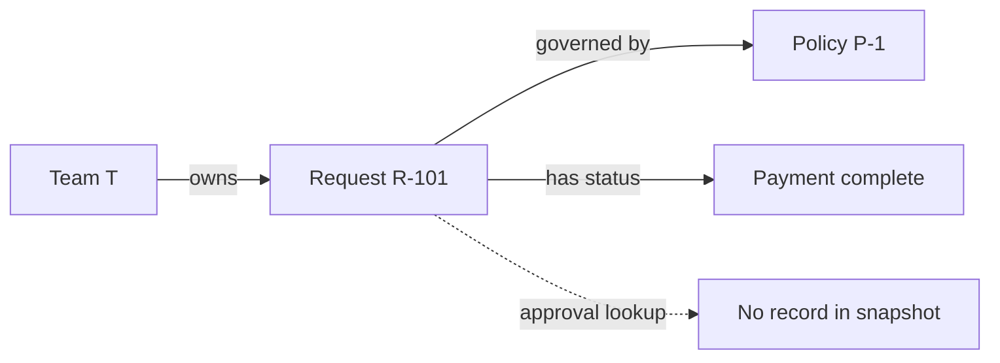

# Worked example: detecting contradictions and missing steps in a business ontology

> Hypothetical training scenario. This is **not** a description of any specific company's actual database, approval policy, Palantir product behavior, or TypeDB semantics.

## Reader and question

Audience: managers unfamiliar with knowledge graphs.

Question: "If we connect business entities, can the AI find contradictory information or missing approvals? And can it predict delays?"

## 1. Explain the practical problem

A purchasing request has a document, a department, an owner, an approval chain, and payment status. Each record exists in different systems. A human may have to inspect several screens before noticing a missing step.

An ontology can give these items shared identities and typed relations, so the request's context can be examined together. **The ontology organizes meaning; rules and evaluations identify a specific issue.**

## 2. The hypothetical facts

| ID | Claim | Source/status |
| --- | --- | --- |
| F1 | Request R-101 is owned by team T | Recorded in request system |
| F2 | R-101 requires finance approval before payment | Example policy P-1 |
| F3 | Payment for R-101 is marked complete | Recorded in payment system |
| F4 | No finance approval is found in the current approval snapshot | Query observation, not necessarily complete |
| F5 | Approval data is synchronized only once daily | Example integration constraint |

## 3. Relationship diagram

Alternative text: Team T owns R-101. Policy P-1 governs R-101, which is marked paid. A lookup found no approval record in the snapshot, but this alone does not prove that approval never occurred.

## 4. What the system can conclude

**Derived finding:** "This paid request lacks *verifiable approval evidence in the current snapshot*." This is a reconciliation alert, not proof of an unauthorized payment.

**To claim an actual violation**, the organization must confirm:
- P-1 applies to this request (amount, type, date, exceptions).
- The approval system and event history are authoritative and sufficiently fresh.
- Every valid approval is recorded and identifiable by request ID.
- No authorized exemption or alternate workflow applies.

Only then can a constraint such as "paid and approval missing under a complete authoritative record" support a violation finding.

## 5. Contradiction, gap, and prediction are different

| Question | Correct result | Extra capability required |
| --- | --- | --- |
| Two systems disagree about the owner | Conflicting assertions to reconcile | Identity matching, source authority, time semantics |
| Approval relation is not in snapshot | Missing-evidence alert | Completeness rule and freshness check |
| Payment completed despite required rejection | Potential policy contradiction | Formal constraints, exceptions, complete evidence |
| Will this request be delayed? | Estimated delay probability or risk score | Training data, predictive model, measured uncertainty |

A relation graph does not automatically deliver any of these results. Each needs a defined method.

## 6. Explain it in one sentence

"An ontology is a shared map of business facts and relationships; rules let us spot specific inconsistencies or gaps on that map, while forecasting requires an additional predictive model."

## 7. Reader comprehension check

- Does 'approval not found' necessarily mean 'approval did not occur'? **No.**
- Can a graph alone estimate future processing delays? **No; a predictive method is required.**
- What should be designed first? **Entity identity, source authority, applicable policies, and exception handling.**
