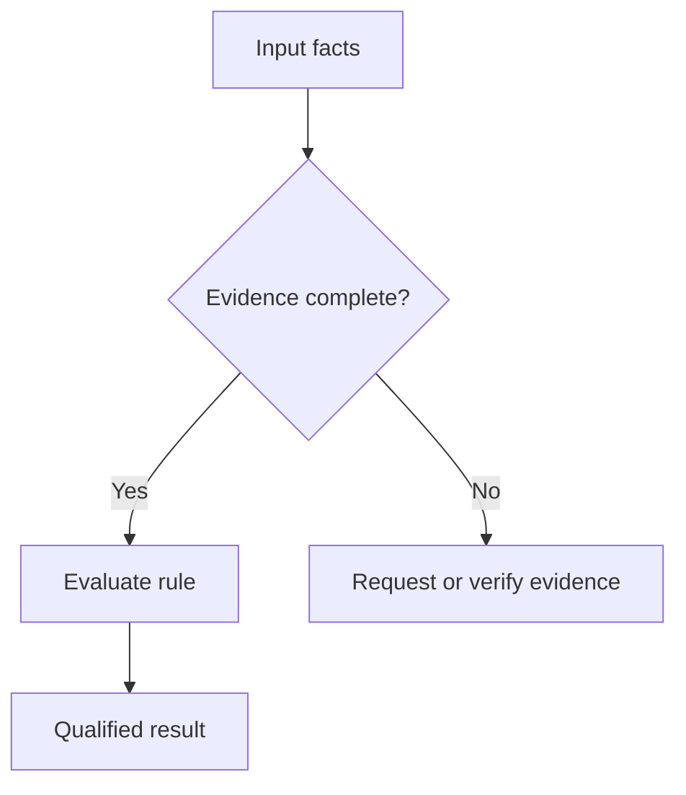

# Explanation patterns

Choose **one primary pattern** based on what the reader needs to learn. More patterns do not necessarily improve comprehension.

## Pattern A — Problem → familiar example → mechanism → result

Use for executive-level explanations of unfamiliar technology.

1. Describe a real operational friction in ordinary language.
2. Introduce a small scenario (two teams, one document, one decision).
3. Show the old way, then the new mechanism.
4. State the operational consequence and a concrete limitation.

Example: "A contract exists, but the responsible owner is not connected to the latest approval record. A relationship model makes that gap queryable; a business rule, not the relationship model alone, decides whether the gap is a violation."

## Pattern B — Known → new → boundary

Use when an intuitive analogy will help.

- Known: a city map connects places and routes.
- New: an ontology connects business objects through typed and governed relations.
- Boundary: a street map does not establish business-policy truth, and an ontology does not detect policy conflicts without explicit conditions, data coverage, and reasoning logic.

Always name the part of the analogy that is *not* equivalent.

## Pattern C — Before / after comparison

Use when the user asks "Why not just use X?".

| Question | Existing method | New design | Real trade-off |
| --- | --- | --- | --- |
| Where is the information? | In tables, reports, or isolated systems | Cross-system entities and relationships | Integration and governance cost |
| Why is this suspicious? | Manual check or isolated rule | Explicit cross-entity constraints | Rules and exceptions must be maintained |
| What happens next? | Human searches and escalates | Workflow can surface review tasks | Authorization and human judgment remain necessary |

Do not argue that one approach replaces all others. Relational tables, ontologies, rules, and ML models can coexist.

## Pattern D — A single worked trace

Use for inference and anomaly detection. Show **inputs → rule → derived output → validation**.

Illustrative case:
- Facts: Request R-101 belongs to department A; step S-2 requires manager approval; no approval event is currently recorded.
- Rule: A request is *ready for payment* only when S-2 approval exists and is valid.
- Derived result: readiness cannot be confirmed.
- Important distinction: "not ready/insufficient evidence" is justified; "manager never approved" is **not** established without event completeness.

To claim a policy violation, document the recording obligation, the authoritative system, synchronization freshness, and permitted exceptions.

## Pattern E — Micro-learning progression

For training material:
1. 30-second definition
2. One visual
3. One example with an expected result
4. One counterexample
5. One question the reader answers

For every new concept, ask: "What would the reader get wrong if this paragraph were removed?"

## Diagram selection

### Relationship graph

Use when understanding *what connects to what* is the goal.

Alternative text: A department owns a request; the request requires approval; an approval is governed by a policy. This is a conceptual example, not a verified system architecture.

### Workflow

Use when order and conditional branching matter.

Do not join the missing-evidence path to a definitive violation outcome without an explicit completeness assumption.

## Anti-patterns

- Starting with a page of acronym definitions.
- Creating a diagram that merely repeats paragraph text.
- Treating correlation, graph adjacency, and logical implication as identical.
- Using a catchy analogy after it has become inaccurate.
- Hiding a significant exception in fine print.
- Calling a forecast "inference" without describing the predictive model.
